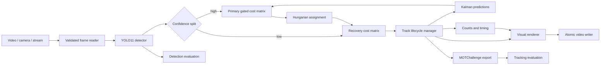
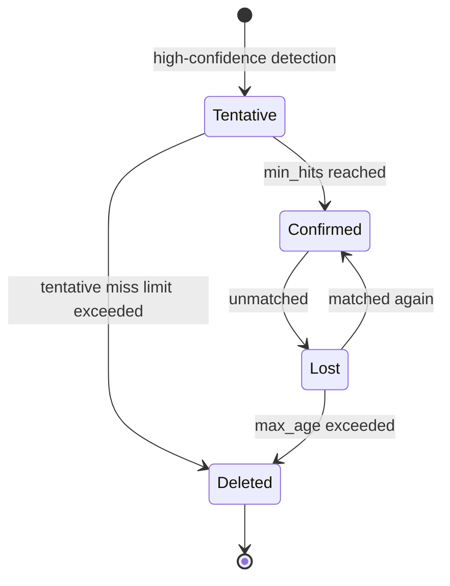

# Autonomous-Perception-Engine

**Real-Time Visual Perception and Multi-Object Tracking for Autonomous Driving**

[](https://github.com/shaafeadawood/Autonomous-Perception-Engine/actions/workflows/ci.yml)
[](https://www.python.org/)
[](LICENSE)
[](https://docs.ultralytics.com/models/yolo11/)

A modular road-scene perception pipeline combining YOLO11 detection, eight-state Kalman filtering, gated Hungarian assignment, track lifecycle management, and reproducible evaluation tooling.

> **Scope:** This is an engineering and research portfolio project—not a vehicle-control system or safety-certified autonomous-driving component.

## Final Project Demonstration

### [▶ Watch Final Object Detection & Tracking Demonstration](https://github.com/shaafeadawood/Autonomous-Perception-Engine/releases/download/v0.1.0/Tesla.Autonomous.Driving.-.Real-Time.Object.Detection.Tracking.mp4)

This recorded workflow demonstrates YOLO object detection, Kalman-filter motion estimation, Hungarian assignment, OpenCV visualization, and real-time multi-object tracking. It showcases the results of an earlier implementation and is not presented as output generated by the current codebase.

The unchanged MP4 is hosted with the [Autonomous Perception Engine - Final Demonstration](https://github.com/shaafeadawood/Autonomous-Perception-Engine/releases/tag/v0.1.0) release.

## Engineering highlights

- YOLO11 detector adapter with configurable model, device, resolution, NMS, confidence bands, and semantic class selection.
- Eight-dimensional Kalman state: bounding-box center, size, and their velocities.
- Two-stage association: high-confidence matching followed by low-confidence recovery.
- Pre-assignment class, IoU, normalized-center-distance, and Mahalanobis gating.
- Tentative, confirmed, lost, and deleted track states with configurable lifecycle rules.
- Persistent monotonic IDs, confidence smoothing, class voting, and motion trails.
- Unique-object, active-object, per-class, and optional directional line-crossing counts.
- Failure-safe video output, codec fallback, overwrite protection, manifests, and optional audio remuxing.
- Detection evaluation, MOTChallenge export/evaluation, and warm-up-aware runtime benchmarking.
- Unit tests, linting, type checking, and GitHub Actions CI.

## Architecture





Detailed design rationale is in [Architecture](docs/architecture.md).

## Installation

Python 3.11 or 3.12 is recommended. Python 3.11–3.13 is supported by the project metadata; actual accelerator support also depends on the available PyTorch build.

```bash
git clone https://github.com/shaafeadawood/Autonomous-Perception-Engine.git
cd Autonomous-Perception-Engine
python -m venv .venv
```

Windows PowerShell:

```powershell
.\.venv\Scripts\Activate.ps1
python -m pip install --upgrade pip
python -m pip install -e ".[evaluation]"
```

Linux/macOS:

```bash
source .venv/bin/activate
python -m pip install --upgrade pip
python -m pip install -e ".[evaluation]"
```

The first inference run downloads the selected Ultralytics model if it is not already cached. Model files are excluded from Git.

## Run inference and tracking

```bash
ape run \
  --config configs/default.yaml \
  --source data/input/road-video.mp4 \
  --output outputs/annotated-road-video.mp4 \
  --mot-output outputs/tracks.txt
```

Useful options:

```text
--device 0          select the first CUDA GPU
--device cpu        force CPU inference
--display           show live output; press q to stop
--overwrite         permit replacement of an existing output
--preserve-audio    remux source audio with FFmpeg when available
```

Every successful run creates a `*.run.json` manifest containing the resolved configuration, environment, frame count, non-accuracy tracking counts, and stage timings.

## Configuration

[configs/default.yaml](configs/default.yaml) is the reproducible baseline. Configuration covers:

- detector model, device, input size, confidence bands, NMS IoU, and target classes;
- Kalman covariance/noise parameters;
- association weights, gates, and maximum costs;
- confirmation, loss, deletion, history, and rendering ages;
- codec selection, audio handling, visualization, and line counting.

[configs/high_accuracy.yaml](configs/high_accuracy.yaml) is a partial override illustrating a higher-resolution starting point. Its name is a configuration intent, not a measured accuracy claim; it must be evaluated on labeled data.

## Tracking methodology

Each track estimates:

```text
x = [cx, cy, width, height, vx, vy, vwidth, vheight]
z = [cx, cy, width, height]
```

The constant-velocity transition matrix uses video FPS to derive `dt`. A Joseph-form covariance update improves numerical stability. Association combines overlap, scale-normalized center displacement, and Kalman innovation distance. Invalid pairs are removed before optimization, preventing impossible matches from distorting the Hungarian solution.

Only unmatched high-confidence detections create new tracks. Lower-confidence detections can recover established tracks but cannot create new identities. This reduces false tracks without hiding the lifecycle rules behind a third-party tracker.

## Evaluation

### Detection

Use a labeled YOLO-format dataset:

```bash
ape evaluate-detection \
  --config configs/default.yaml \
  --data path/to/dataset.yaml \
  --output outputs/detection-metrics.json
```

The command records precision, recall, mAP@0.50, mAP@0.50:0.95, mAP@0.75, available per-class results, and the resolved configuration.

### Tracking

Generate MOTChallenge predictions with `ape run --mot-output`, then evaluate against identity-labeled ground truth:

```bash
ape evaluate-tracking \
  --ground-truth path/to/gt.txt \
  --predictions outputs/tracks.txt \
  --output outputs/tracking-metrics.json
```

The evaluator reports IDF1, MOTA, MOTP, ID switches, misses, false positives, fragmentation, precision, and recall. The export can also be consumed by TrackEval for HOTA analysis.

### Runtime

```bash
ape benchmark \
  --config configs/default.yaml \
  --source data/input/road-video.mp4 \
  --output outputs/runtime.json \
  --frames 300 \
  --warmup 10
```

Benchmark output separates reading, detection, tracking, and total latency, excludes warm-up frames, synchronizes CUDA timing, and records its environment. Runtime measurements are explicitly not accuracy measurements.

No dataset accuracy or hardware-performance results are claimed in this repository until the corresponding commands have been run on documented inputs.

## Verified software status

Validated locally on October 25, 2026 using Windows 11 and Python 3.13.6:

| Check | Verified result |
|---|---:|
| Unit and synthetic integration tests | 28 passed |
| Branch-aware test coverage | 77% |
| Ruff | Passed |
| mypy | Passed across 28 source files |
| Package dependency consistency | Passed with `pip check` |
| Real YOLO11 CPU smoke test | 10/10 frames processed |

The real-model smoke test used a locally cached Ultralytics sample asset that is not included in this repository. It produced five consistent confirmed IDs across frames 3–10 (one bus and four people). This verifies detector/tracker integration and confirmation behavior; it is not an accuracy evaluation or performance claim.

## Development

```bash
python -m pip install -e ".[dev,evaluation]"
ruff check .
mypy src
pytest --cov --cov-report=term-missing
```

The unit suite covers geometry, Kalman behavior, gated assignment, two-stage recovery, lifecycle transitions, counting, MOT evaluation, atomic video I/O, and an end-to-end synthetic-video pipeline with an injected detector.

## Project layout

```text
configs/                         reproducible runtime profiles
data/                            local-only dataset guidance
docs/                            architecture, evaluation, and demo guides
src/autonomous_perception_engine/
  detection/                     detector interface and YOLO11 adapter
  tracking/                      Kalman filter, association, tracks, manager
  pipeline/                      video I/O and end-to-end orchestration
  analytics/                     object counts and timing summaries
  visualization/                 overlays and track trails
  evaluation/                    detection, MOT, benchmark, export tools
tests/                           deterministic unit and synthetic integration tests
```

## Known limitations

- COCO-pretrained YOLO11 does not cover every traffic-sign category.
- Motion-only tracking cannot reliably preserve identity through long occlusions or visually ambiguous crossings.
- Camera ego-motion is not explicitly compensated.
- Distance, speed, collision risk, lanes, and free-space estimates are outside the current scope.
- Default thresholds are engineering starting points, not dataset-optimized values.
- Counts depend on detector and tracker quality; they are not ground truth.
- Model licensing and dataset/media licensing must be reviewed for every deployment.

## License

This independently written project is licensed under [AGPL-3.0](LICENSE) to align with the open-source Ultralytics integration. Commercial or closed-source deployments may require an Ultralytics Enterprise license.

Dependency licenses and model-distribution considerations are documented in [Third-party notices](THIRD_PARTY_NOTICES.md).
