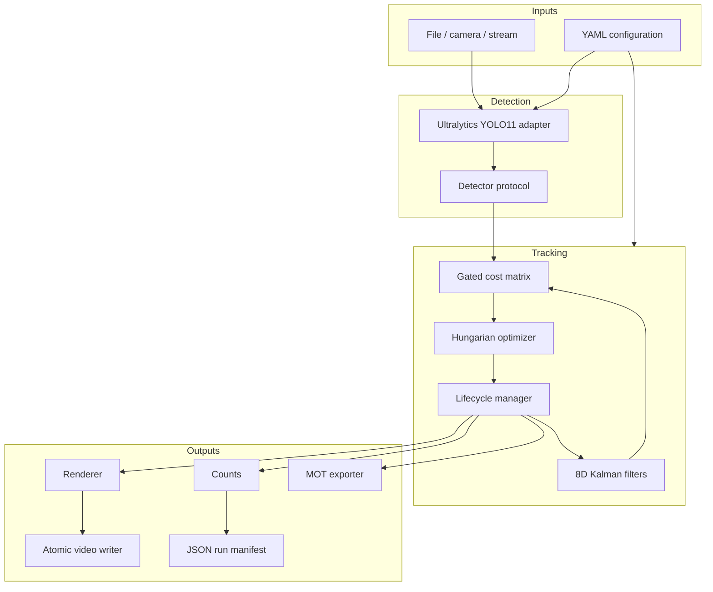
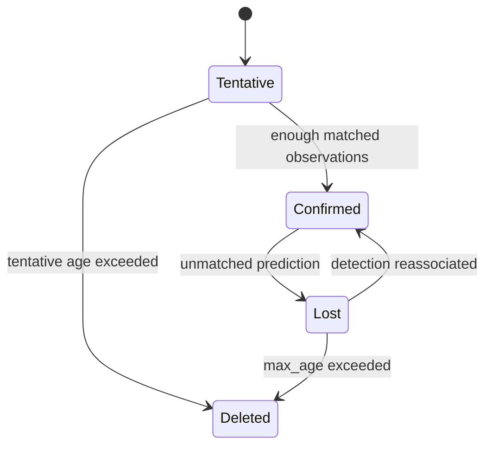

# Architecture

## Design goals

Autonomous Perception Engine separates model inference, state estimation, association, lifecycle management, I/O, presentation, and evaluation. This makes the motion tracker testable without a GPU or model download and prevents notebook state from becoming part of the runtime contract.

## Component boundaries



The `Detector` protocol permits deterministic test doubles and future detector backends without changing tracking logic. The pipeline accepts normalized `Detection` instances and exposes immutable `TrackSnapshot` values to downstream consumers.

## Kalman state estimation

Each track uses the state:

```text
x = [cx, cy, w, h, vx, vy, vw, vh]ᵀ
z = [cx, cy, w, h]ᵀ
```

The state transition is a constant-velocity model:

```text
cx' = cx + vx × dt
cy' = cy + vy × dt
w'  = w  + vw × dt
h'  = h  + vh × dt
```

`dt` is derived from the validated source FPS. Position and size use separate process-noise parameters. Measurement noise also distinguishes center coordinates from box size. The correction step uses the Joseph covariance form:

```text
P = (I − KH) P (I − KH)ᵀ + K R Kᵀ
```

This form is more resistant to covariance asymmetry and numerical degradation than the abbreviated update.

## Association

For every allowed track/detection pair, association computes:

```text
C = wiou × (1 − IoU)
  + wcenter × normalized_center_distance
  + wmahalanobis × normalized_innovation_distance
```

The center distance is divided by the average box diagonal so a fixed pixel threshold does not behave differently merely because the video resolution or object scale changes. Mahalanobis distance incorporates the filter's predicted uncertainty.

Pairs are invalidated before Hungarian optimization when they violate class compatibility, innovation distance, or both the IoU and center-distance gates. Post-assignment maximum costs provide another rejection boundary.

Association has two stages:

1. All live tracks compete for high-confidence detections.
2. Remaining established tracks compete for low-confidence detections.

Only unmatched high-confidence detections create tracks. Tentative tracks cannot be recovered by weak detections. This preserves useful low-confidence evidence without allowing every weak detection to create an identity.

## Lifecycle



- `min_hits` prevents one-frame false positives from becoming visible identities.
- `max_tentative_age` bounds how long an unconfirmed hypothesis survives.
- `max_age` permits short occlusion recovery.
- `render_max_age` is intentionally separate: a track may remain associable longer than its predicted box remains visible.

Track IDs are monotonically allocated for one pipeline run and never recycled during that run. They are not global identities across separate videos or executions.

## Output integrity

The video writer targets a unique partial file beside the destination. The partial file is atomically renamed only after the writer closes and produces non-empty output. Exceptions remove the partial artifact. Existing destinations are rejected unless overwrite is explicitly enabled.

The output video is silent by default. `--preserve-audio` asks FFmpeg to remux optional source audio after successful visual processing without re-encoding the video stream.

## Reproducibility record

Each completed run writes a JSON manifest containing:

- UTC timestamps;
- resolved source/output paths;
- frame count, resolution, and FPS;
- detector count and unique confirmed-track counts;
- stage latency summaries;
- complete resolved configuration;
- Python, platform, and core package versions;
- codec and audio-remux status.

These data make a run inspectable, but they do not replace accuracy evaluation.
